# TP 3 — Premiers conteneurs avec Docker

**Cours :** Introduction au Cloud — L3 SI (BDGL), séance 3
**Étudiant(e) / binôme :** TRA BI TRA Christian David / Kouadio Yao Boffouo Siedou
**Date :** 28-29 octobre 2026

**Machine hôte :** Intel Core i5-6300U (2 cœurs, 4 processeurs logiques), 16 Go de RAM, Windows 11
**Logiciels :** VirtualBox 7.2.20, VM `ubuntu-srv` (Ubuntu Server 26.04.1 LTS), Docker Engine 29.1.3

> Dans ce compte rendu, les blocs de code montrent les commandes lancées. Les captures d'écran sont dans le dossier `images/`, à côté de ce fichier. L'invite `PS C:\...>` indique une commande lancée dans PowerShell sur l'hôte Windows, et `etudiant@ubuntu-srv:~$` une commande lancée dans la VM.

---

## Introduction

Aux TP 1 et 2, j'ai créé des machines virtuelles complètes. Dans ce TP, on emballe seulement **une application et ses dépendances** dans une **image Docker**, qui peut ensuite tourner à l'identique sur la VM, sur une VM du cloud ou dans un service de conteneurs managé. Docker est installé dans la VM `ubuntu-srv` (et non sous Windows) pour tourner nativement sur le noyau Linux, comme sur un serveur cloud.

**Objectifs :**
- installer Docker, lancer et inspecter des conteneurs (`hello-world`, Nginx) ;
- comprendre qu'un conteneur est éphémère et utiliser un volume ;
- comparer un conteneur et une VM (taille, démarrage, mémoire) ;
- écrire un Dockerfile pour l'API fil rouge, construire l'image et observer le cache ;
- publier l'image dans un registre (GitHub Container Registry), la récupérer, puis nettoyer.

**Architecture mise en place :**

```
Navigateur Windows (hôte)
   127.0.0.1:8080 ---> redirection VirtualBox ---> VM ubuntu-srv :8080
   127.0.0.1:5000 ---> redirection VirtualBox ---> VM ubuntu-srv :5000
                                                        |
                              Docker (-p 8080:80)       |  Docker (-p 5000:5000)
                                  +---------------------+----------------+
                                  v                                      v
                        conteneur web (nginx)                  conteneur api (api:1.0 / 1.1)
                        port 80                                port 5000
              (les deux conteneurs partagent le noyau Linux de la VM)
```

| Conteneur | Image | Port dans le conteneur | Port dans la VM | Adresse depuis l'hôte |
|---|---|---|---|---|
| web | nginx | 80 | 8080 | http://127.0.0.1:8080 |
| api | api:1.0 puis api:1.1 | 5000 | 5000 | http://127.0.0.1:5000 |

## Plan du compte rendu

1. Termes importants
2. Partie 0 : préparer la VM et installer Docker
3. Partie 1 : lancer et inspecter des conteneurs
4. Partie 2 : comparer conteneur et VM
5. Partie 3 : conteneuriser l'API fil rouge
6. Partie 4 : publier l'image et nettoyer
7. Difficultés rencontrées et solutions
8. Lien avec le cloud
9. Aide-mémoire des commandes
10. Conclusion

## Termes importants

| Terme | Définition | Dans ce TP |
|---|---|---|
| **Conteneur** | Processus (ou groupe de processus) isolé du reste du système par le noyau, qui partage le noyau de l'hôte. | `web`, `api` |
| **Image** | Modèle en lecture seule (système de fichiers et configuration) à partir duquel on lance des conteneurs. Elle est faite de couches. | `nginx`, `api:1.1` |
| **Couche (layer)** | Résultat d'une instruction du Dockerfile ; les couches sont mises en cache et partagées entre images. | `docker history` |
| **Dockerfile** | Fichier texte qui décrit comment construire une image. | `~/api/Dockerfile` |
| **Démon Docker** | Service qui crée et exécute les conteneurs ; le client `docker` lui envoie les commandes. | `docker.service` |
| **Registre** | Serveur qui stocke et distribue des images (Docker Hub, GHCR, etc.). | `ghcr.io` |
| **Tag** | Étiquette de version d'une image (`1.1`, `latest`). | `api-fil-rouge:1.1` |
| **Volume (bind mount)** | Dossier de l'hôte monté dans un conteneur, qui survit à la suppression du conteneur. | `-v ~/site:/usr/share/nginx/html:ro` |
| **Publication de port** | Option `-p H:C` qui relie le port H de l'hôte au port C du conteneur. | `-p 8080:80` |
| **Namespaces et cgroups** | Fonctions du noyau Linux qui isolent les processus (namespaces) et limitent leurs ressources (cgroups). | base des conteneurs |
| **Variable d'environnement** | Valeur passée au conteneur au lancement, sans modifier l'image. | `-e BINOME=...` |
| **Cache de build** | Réutilisation des couches inchangées lors d'une reconstruction. | lignes `CACHED` |

---

## Partie 0 — Préparer la VM et installer Docker

### 0.1 Démarrer la VM et ouvrir les ports

```powershell
$env:Path += ";C:\Program Files\Oracle\VirtualBox"
VBoxManage list runningvms
VBoxManage startvm ubuntu-srv --type headless
VBoxManage controlvm ubuntu-srv natpf1 "web,tcp,127.0.0.1,8080,,8080"
VBoxManage controlvm ubuntu-srv natpf1 "api,tcp,127.0.0.1,5000,,5000"
VBoxManage showvminfo ubuntu-srv | Select-String "Rule"
ssh -p 2222 etudiant@127.0.0.1
```

`showvminfo` liste bien les trois redirections : `ssh` (2222 vers 22), `web` (8080 vers 8080) et `api` (5000 vers 5000). Ma première tentative de démarrage contenait une faute de frappe (`--type headles`) qui a été refusée, puis corrigée. La clé SSH de la VM ayant changé depuis la séance précédente, j'ai dû supprimer l'ancienne entrée avec `ssh-keygen -R "[127.0.0.1]:2222"` avant de me reconnecter (voir la capture).

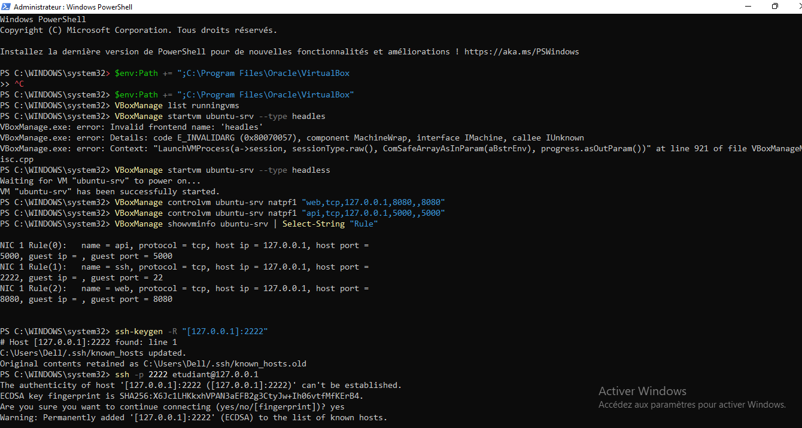

### 0.2 Installer Docker

```bash
sudo apt update
sudo apt install -y docker.io docker-buildx docker-compose-v2
sudo usermod -aG docker $USER
exit
```

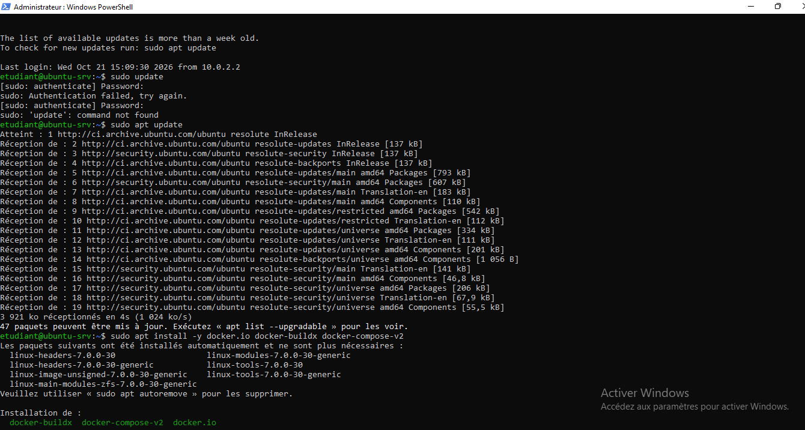

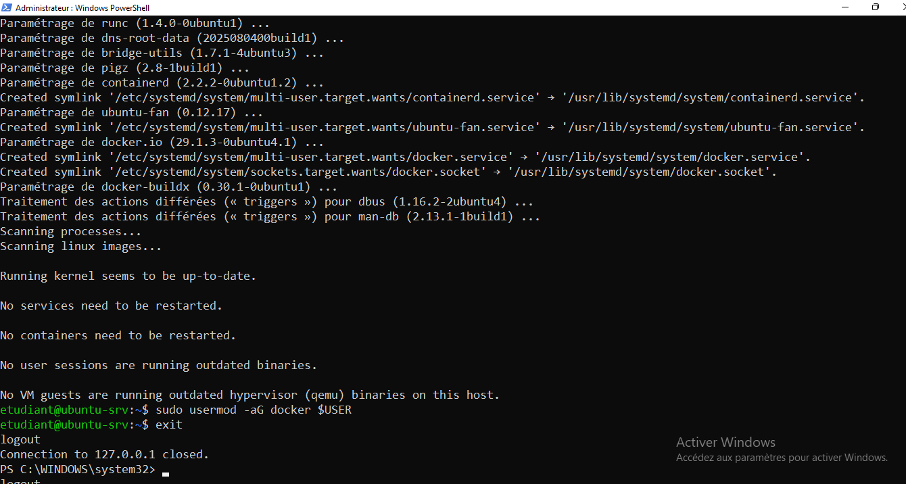

Après reconnexion SSH (pour que le groupe `docker` soit pris en compte) :

```bash
docker version
docker info | grep -E "Server Version|Storage Driver|Cgroup|Kernel Version"
```

```
Server Version: 29.1.3
Storage Driver: overlayfs
Cgroup Driver: systemd
Cgroup Version: 2
Kernel Version: 7.0.0-38-generic
```

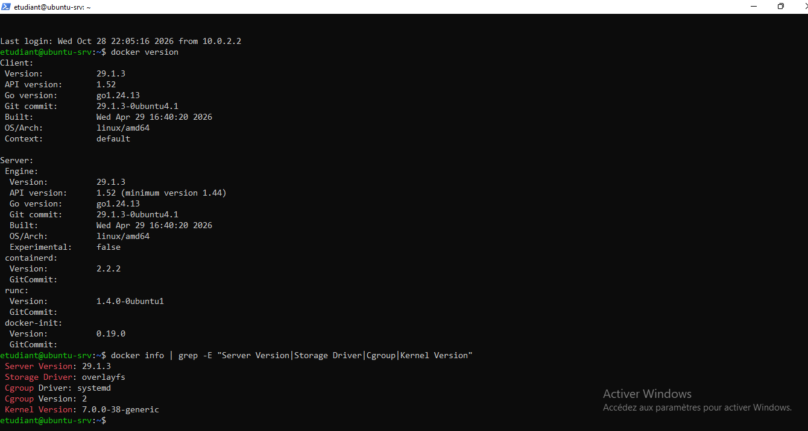

### Questions

**Q1. Quelle version de Docker est installée ? Quel noyau Docker utilise-t-il ?**
Docker Engine **29.1.3** (client et serveur, API 1.52), installé depuis les dépôts Ubuntu (`docker.io`), avec le pilote de stockage `overlayfs` et cgroup v2 géré par `systemd`. La ligne *Kernel Version* indique **7.0.0-38-generic** : c'est le noyau Linux de la VM `ubuntu-srv`. Docker n'a pas de noyau propre, les conteneurs utilisent celui de la machine hôte.

**Q2. Être membre du groupe `docker` revient presque à être administrateur. Pourquoi ? Quelle précaution sur un serveur partagé ?**
Le démon Docker tourne en **root**, et appartenir au groupe `docker` donne accès à sa socket (`/var/run/docker.sock`). Un membre du groupe peut donc demander à Docker de lancer un conteneur qui monte **tout le système de fichiers de la machine** avec les droits root (par exemple `docker run -v /:/hote ...`), puis lire ou modifier n'importe quel fichier (`/etc/shadow`, clés SSH, etc.). C'est équivalent à avoir les droits administrateur sans passer par `sudo`. Sur un serveur partagé, il ne faut ajouter au groupe `docker` que des personnes de confiance, comme pour `sudo`, ou utiliser Docker en mode *rootless*.

---

## Partie 1 — Lancer et inspecter des conteneurs

### 1.1 Premier conteneur

```bash
docker run hello-world
docker images
docker ps -a
```

L'image `hello-world` n'existait pas en local : Docker l'a téléchargée, puis a exécuté le conteneur, qui a affiché son message et s'est arrêté (`Exited (0)`). L'image fait 25,9 kB sur disque et le conteneur a reçu un nom aléatoire (`awesome_euler`).

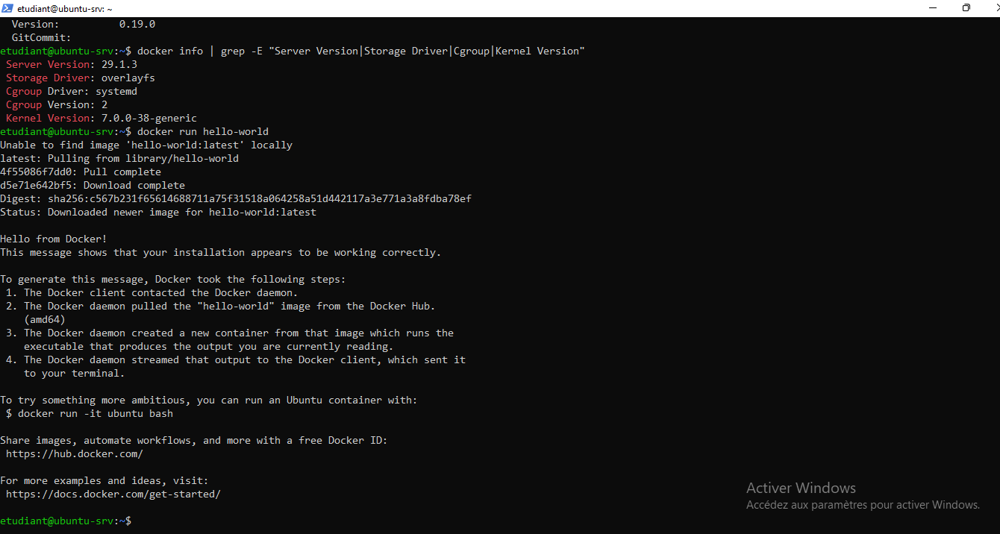

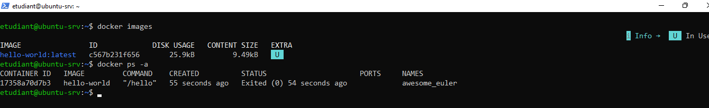

### 1.2 Un serveur web en une commande

```bash
docker run -d --name web -p 8080:80 nginx
docker ps
curl -s http://localhost:8080 | head -n 5
```

Le `curl` renvoie `<title>Welcome to nginx!</title>`, et la page s'affiche dans le navigateur de l'hôte sur `http://127.0.0.1:8080` (le navigateur l'a traduite automatiquement en français).

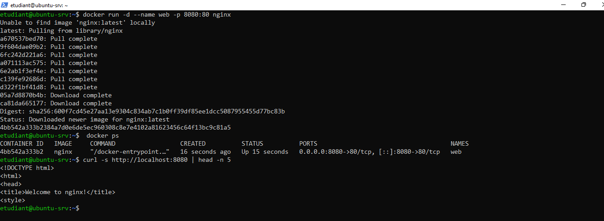

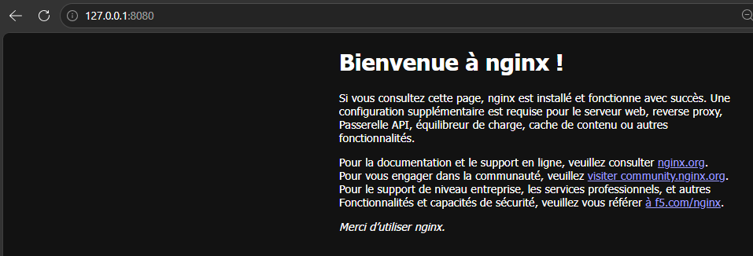

### 1.3 Regarder à l'intérieur

```bash
docker exec web cat /etc/os-release | head -n 2
cat /etc/os-release | head -n 2
docker exec web uname -r
uname -r
```

| | Conteneur `web` | VM `ubuntu-srv` |
|---|---|---|
| Distribution | Debian GNU/Linux 13 (trixie) | Ubuntu 26.04.1 LTS |
| Noyau (`uname -r`) | 7.0.0-38-generic | 7.0.0-38-generic |

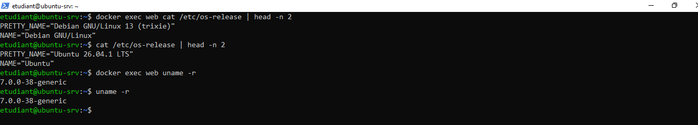

```bash
docker logs --tail 5 web
docker top web
ps aux | grep "nginx: master" | grep -v grep
docker stats --no-stream web
```

`docker top` montre un processus maître (`nginx: master`, PID **2944**) et deux processus `worker` ; ce même PID 2944 apparaît dans `ps aux` sur la VM. `docker stats` indique **3,426 MiB** de mémoire (0,21 % de 1,604 GiB), 0,00 % de CPU et 3 processus. Les journaux montrent la requête du `curl` (client 172.17.0.1) et celle du navigateur (client 10.0.2.2) ; l'erreur sur `favicon.ico` est normale, la page par défaut n'a pas d'icône.

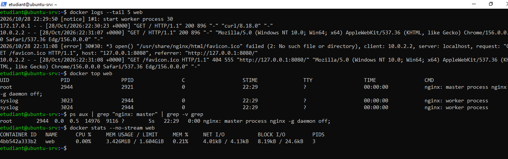

### 1.4 Un conteneur est éphémère

```bash
docker exec web sh -c 'echo "<h1>Binôme TRA BI TRA CHRISTIAN DAVID - KOUADIO BOFFOUO</h1>" > /usr/share/nginx/html/index.html'
curl -s http://localhost:8080
docker rm -f web
docker run -d --name web -p 8080:80 nginx
curl -s http://localhost:8080 | grep -o "<title>.*</title>"
```

Ma page personnalisée s'affiche, puis après `docker rm -f web` et un nouveau `docker run`, c'est de nouveau `<title>Welcome to nginx!</title>`.

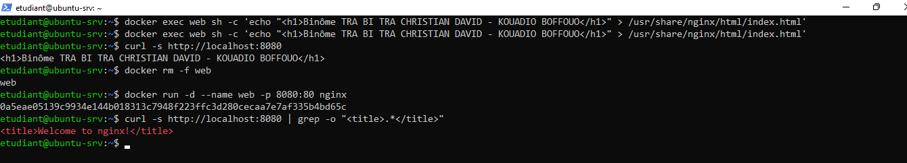

### 1.5 Garder la page avec un volume

```bash
mkdir -p ~/site
echo "<h1>Binôme TRA BI TRA CHRISTIAN DAVID - KOUADIO BOFFOUO : servi depuis un volume</h1>" > ~/site/index.html
docker rm -f web
docker run -d --name web -p 8080:80 -v ~/site:/usr/share/nginx/html:ro nginx
curl -s http://localhost:8080
```

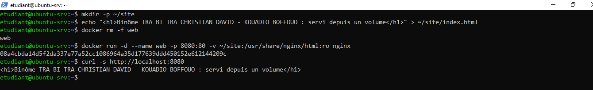

Pour vérifier la persistance, j'ai supprimé le conteneur et l'ai recréé avec le même volume : la page est toujours servie.

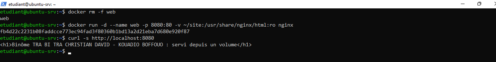

### Questions

**Q1. D'après le message de `hello-world`, quelles sont les quatre étapes réalisées par Docker ?**
1. Le **client** Docker (la commande `docker`) contacte le **démon** Docker.
2. Le démon **télécharge** l'image `hello-world` depuis Docker Hub (version amd64), car elle n'existait pas en local.
3. Le démon **crée un nouveau conteneur** à partir de cette image, qui exécute le programme produisant le message.
4. Le démon **renvoie la sortie** au client, qui l'affiche dans le terminal.

**Q2. Le conteneur `web` et la VM ont-ils la même distribution ? Le même noyau ?**
**Distribution : non.** Le conteneur contient un système de fichiers Debian 13 (embarqué dans l'image `nginx`), alors que la VM tourne sous Ubuntu 26.04. **Noyau : oui**, les deux affichent `7.0.0-38-generic`. Un conteneur n'embarque pas de noyau : c'est un processus isolé (namespaces, cgroups) qui s'exécute sur le noyau de la machine hôte, alors qu'une VM démarre son propre système complet avec son propre noyau (cours, séance 3).

**Q3. Les processus Nginx du conteneur apparaissent-ils dans `ps aux` sur la VM ?**
**Oui** : le `nginx: master process` apparaît dans `ps aux` sur la VM avec le même PID (2944) que dans `docker top`. Un conteneur n'est donc pas une machine à part, mais un **ensemble de processus ordinaires du système hôte**, isolés par les namespaces et limités par les cgroups. Depuis l'intérieur du conteneur, Nginx se voit comme le processus n°1, alors que l'hôte le voit avec un PID normal.

**Q4. Chemin d'une requête du navigateur de l'hôte jusqu'à Nginx ?**
1. Le navigateur Windows appelle `http://127.0.0.1:8080`.
2. **Redirection VirtualBox** (règle NAT `web`) : le port 8080 de Windows est envoyé vers le port 8080 de la VM.
3. **Redirection Docker** (`-p 8080:80`) : le port 8080 de la VM est envoyé vers le port 80 du conteneur.
4. Nginx reçoit la requête sur son port 80 et répond par le même chemin en sens inverse.

**Q5. Pourquoi la page modifiée a-t-elle disparu après `docker rm` ? Que change l'option `-v` ?**
La modification a été écrite dans la **couche inscriptible du conteneur**, propre à ce conteneur et supprimée avec lui. L'image `nginx` n'a jamais changé, donc le nouveau conteneur repart de la page par défaut : un conteneur est **éphémère**. Avec `-v`, un dossier de la VM est **monté** dans le conteneur : les fichiers sont stockés sur la VM, en dehors du conteneur, et survivent à sa suppression (ma page « servi depuis un volume » est toujours là après `docker rm -f web`).

---

## Partie 2 — Comparer conteneur et VM

```bash
docker pull alpine
docker images
time docker run --rm alpine echo "Bonjour depuis un conteneur"
time docker run --rm alpine echo "Bonjour depuis un conteneur"
docker run --rm alpine cat /etc/os-release
systemd-analyze
free -h
```

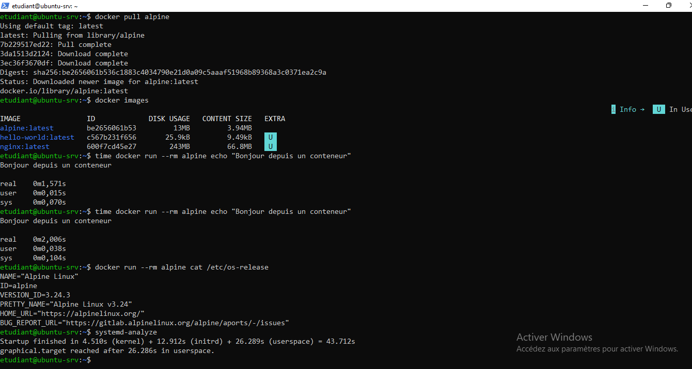

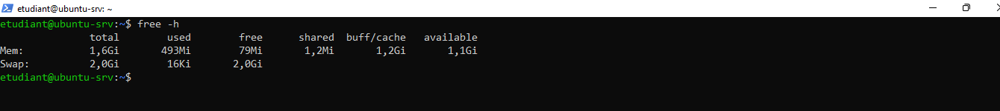

**Mesures brutes :**
- Démarrage de la VM : 4,510 s (noyau) + 12,912 s (initrd) + 26,289 s (userspace) = **43,712 s**.
- `time docker run` d'Alpine : 1,571 s la première fois, **2,006 s** la deuxième (ligne `real`).
- Mémoire de la VM : 493 Mi utilisés sur 1,6 Gi.
- Tailles des images : `nginx` 243 MB, `alpine` 13 MB (3,94 MB de contenu).

**Tableau comparatif :**

| Mesure | VM `ubuntu-srv` | Conteneur `nginx` | Conteneur `alpine` |
|---|---|---|---|
| Taille sur disque | 7,17 Go (dossier de la VM, TP 1) | 243 MB | 13 MB |
| Temps de démarrage | 43,712 s (`systemd-analyze`) | — | 2,006 s (2e `time docker run`) |
| Mémoire utilisée | 493 Mi (`free -h`, colonne `used`) | 3,426 MiB (`docker stats`) | — |
| Système | Ubuntu 26.04.1 complet + noyau | Debian GNU/Linux 13 (trixie) | Alpine Linux v3.24 |

### Questions

**Q1. Dans quel rapport le conteneur est-il plus léger et plus rapide que la VM ?**
- **Taille :** 7,17 Go contre 243 MB (Nginx), soit environ **×30**, et contre 13 MB (Alpine), soit environ **×550**.
- **Mémoire :** 493 Mi contre 3,4 MiB, soit environ **×140**.
- **Démarrage :** 43,7 s contre 2 s, soit environ **×20**.

Les mesures confirment l'ordre de grandeur du cours : un conteneur est beaucoup plus léger et plus rapide qu'une VM. La comparaison a deux limites : le dossier de la VM contient aussi son instantané et son état sauvegardé, et la mémoire de la VM (493 Mi) inclut tout le système.

**Q2. Pourquoi le premier `time docker run` est-il plus long que le second ?**
En théorie, le premier lancement doit mettre en place l'image et ses fichiers (qui viennent d'être téléchargés), alors que les suivants profitent du cache du système. **Dans mes mesures, c'est l'inverse** : 1,571 s la première fois et 2,006 s la deuxième. Je rapporte les chiffres tels quels. L'écart est petit et vient sans doute de la VM, qui a peu de mémoire libre (79 Mi libres sur 1,6 Gi) et dont les performances varient d'une mesure à l'autre. Cela montre qu'une mesure isolée est peu fiable : il faudrait la répéter plusieurs fois et faire une moyenne.

**Q3. Un cas où choisir quand même une VM plutôt qu'un conteneur ?**
Quand il faut une **isolation forte** ou un **système différent** de celui de l'hôte. Les conteneurs partagent le noyau de l'hôte : on ne peut pas lancer Windows dans un conteneur sur un hôte Linux. Une VM est aussi préférable pour héberger des applications non fiables de clients différents (location de serveurs), ou une application qui exige son propre noyau ou ses propres modules noyau.

---

## Partie 3 — Conteneuriser l'API fil rouge

### 3.1 Le code de l'API

```bash
mkdir -p ~/api && cd ~/api
cat > app.py <<'EOF'
import os
import socket
from flask import Flask, jsonify

app = Flask(__name__)

@app.get("/")
def accueil():
    return jsonify(
        message="API fil rouge",
        binome=os.environ.get("BINOME", "inconnu"),
        conteneur=socket.gethostname(),
    )

@app.get("/sante")
def sante():
    return jsonify(statut="ok")

if __name__ == "__main__":
    app.run(host="0.0.0.0", port=5000)
EOF
echo "flask>=3,<4" > requirements.txt
```

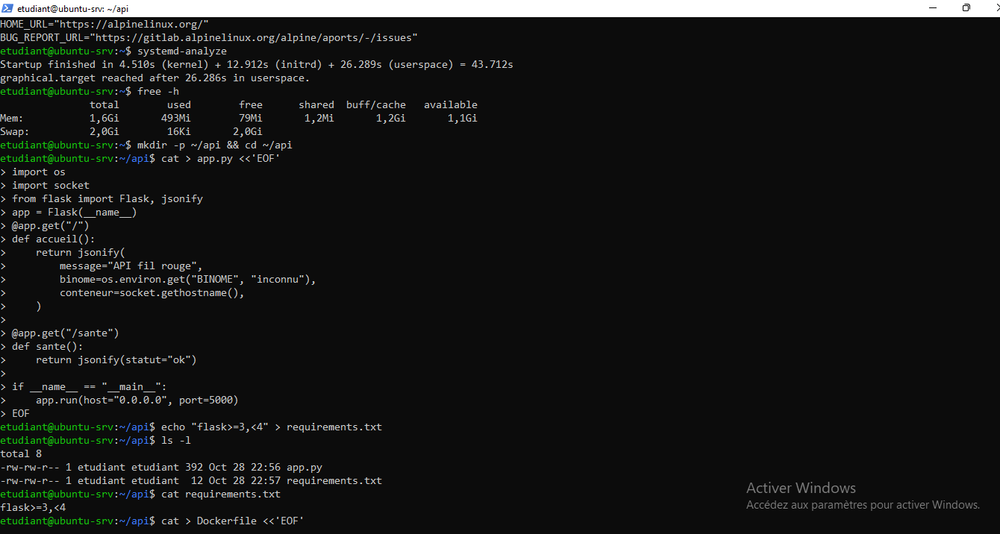

### 3.2 Le Dockerfile et le .dockerignore

```bash
cat > Dockerfile <<'EOF'
FROM python:3.12-slim
WORKDIR /app
COPY requirements.txt .
RUN pip install --no-cache-dir -r requirements.txt
COPY . .
EXPOSE 5000
CMD ["python", "app.py"]
EOF
printf '__pycache__/\n*.pyc\n.git\n' > .dockerignore
```

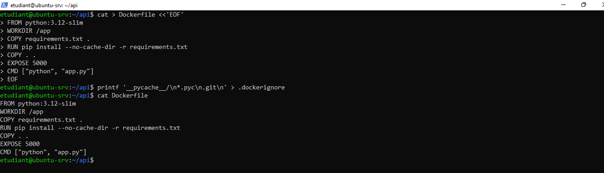

### 3.3 Construire l'image

```bash
docker build -t api:1.0 .
docker images api
docker history api:1.0
```

La construction a pris 41 s (téléchargement de `python:3.12-slim`, `pip install` en 11,2 s). L'image `api:1.0` fait **198 MB** sur disque (48,3 MB de contenu).

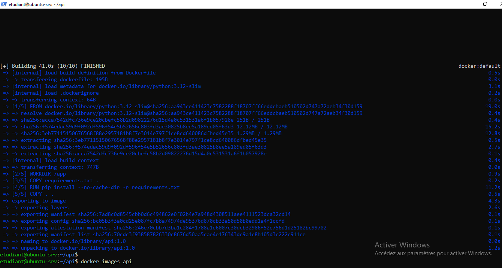

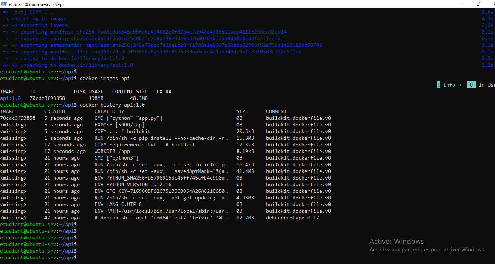

### 3.4 Lancer l'API

```bash
docker run -d --name api -p 5000:5000 -e BINOME="TRA BI TRA CHRISTIAN DAVID-KOUADIO BOFFOUO" api:1.0
curl -s http://localhost:5000
curl -s http://localhost:5000/sante
docker logs api
```

Réponses obtenues :

```
{"binome":"TRA BI TRA CHRISTIAN DAVID-KOUADIO BOFFOUO","conteneur":"c57b66823b25","message":"API fil rouge"}
{"statut":"ok"}
```

Les deux premiers `curl` n'ont rien renvoyé parce que Flask n'avait pas fini de démarrer ; je les ai relancés ensuite. Flask affiche « This is a development server », ce qui est normal pour ce TP.

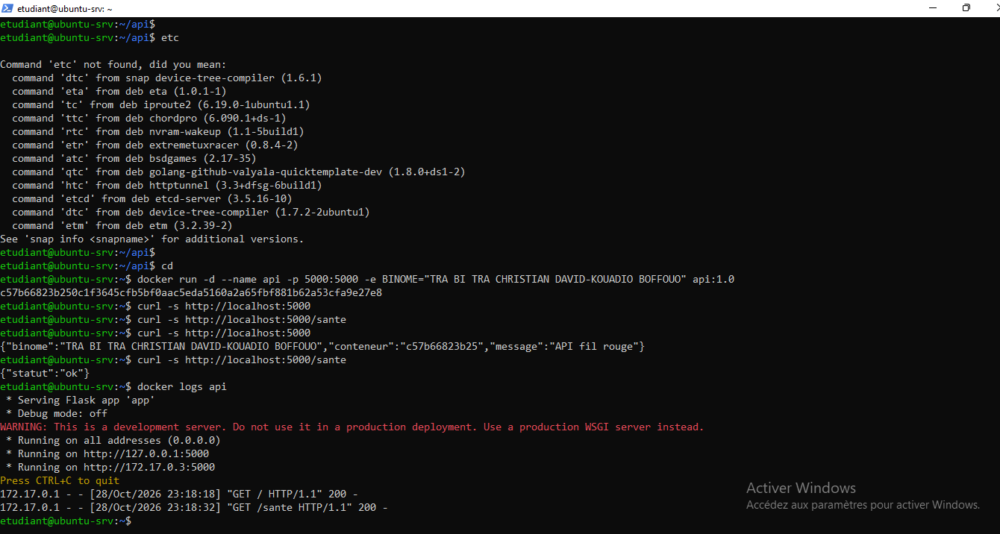

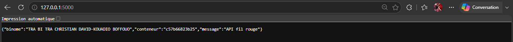

### 3.5 Trois copies de la même image

```bash
for p in 5001 5002 5003; do docker run -d --name api-$p -p $p:5000 -e BINOME="TRA BI TRA CHRISTIAN DAVID-KOUADIO BOFFOUO" api:1.0; done
for p in 5001 5002 5003; do curl -s http://localhost:$p; echo; done
docker rm -f api-5001 api-5002 api-5003
```

Les champs `conteneur` valent `bddb11f97293` (5001), `46b04d67c3ae` (5002) et `7551279b5402` (5003).

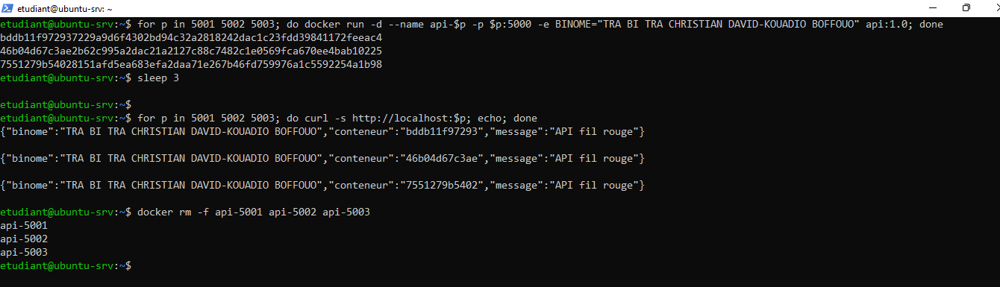

### 3.6 Nouvelle version avec la route /version

J'ai ajouté dans `app.py` la route `/version` (voir `api/app.py` dans le dépôt), puis reconstruit :

```bash
docker build -t api:1.1 .
docker rm -f api && docker run -d --name api -p 5000:5000 api:1.1
curl -s http://localhost:5000/version
```

La construction n'a pris que **4,8 s** : les étapes `WORKDIR`, `COPY requirements.txt` et `RUN pip install` sont marquées **CACHED**, seule `COPY . .` est refaite. Le `curl` renvoie `{"version":"1.1"}`. La capture montre aussi un premier `docker build` qui avait échoué sur un problème réseau passager avec Docker Hub (voir les difficultés).

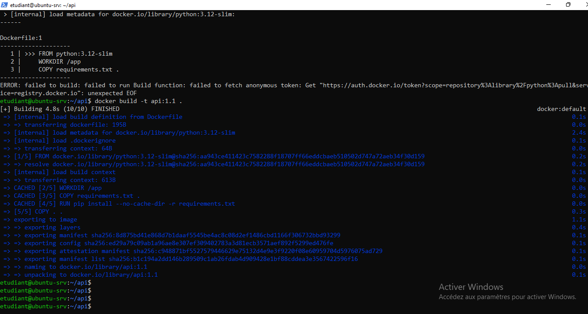

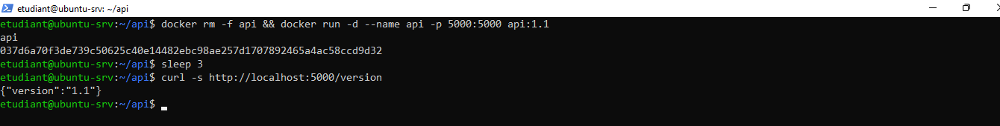

### Questions

**Q1. Quelle est la taille de l'image `api:1.0` ? Combien de couches `docker history` affiche-t-il, et lesquelles viennent de mon Dockerfile ?**
L'image `api:1.0` fait **198 MB** sur disque (48,3 MB de contenu). `docker history` affiche **16 lignes** (couches). **6** viennent de mon Dockerfile (de haut en bas) : `CMD ["python" "app.py"]` (0 B), `EXPOSE 5000/tcp` (0 B), `COPY . .` (20,5 kB, mon code), `RUN pip install ...` (15,3 MB, Flask et ses dépendances), `COPY requirements.txt .` (12,3 kB) et `WORKDIR /app` (8,19 kB). Les **10 autres** viennent de l'image de base `python:3.12-slim` (Debian 13 trixie : 87,7 MB, installation de Python : 41,4 MB, variables d'environnement, etc.). Les couches de 0 B sont des métadonnées qui n'ajoutent pas de fichiers.

**Q2. Pourquoi copier `requirements.txt` et installer les dépendances avant de copier le code ?**
Docker réutilise une couche tant que sa commande et les fichiers qu'elle utilise n'ont pas changé, mais **dès qu'une couche change, toutes les suivantes sont refaites**. Mon code change souvent, alors que `requirements.txt` change rarement. En copiant d'abord `requirements.txt` et en lançant `pip install`, ces couches restent en cache quand je modifie seulement `app.py` : c'est ce que montrent les lignes `CACHED` de l'étape 6 (4,8 s au lieu de 41 s). Si je copiais tout le code avant `pip install`, la moindre modification de `app.py` forcerait à réinstaller Flask à chaque construction.

**Q3. Que renvoie le champ `conteneur` pour les trois copies de l'étape 5 ? Quelle caractéristique du cloud cela illustre-t-il ?**
Le champ `conteneur` contient le nom d'hôte du conteneur, c'est-à-dire son identifiant, **différent pour chaque copie** (`bddb11f97293`, `46b04d67c3ae`, `7551279b5402`) alors que l'image et le code sont identiques. Cette expérience illustre l'**élasticité rapide** (passage à l'échelle à la demande, séance 1) : à partir d'une seule image, on lance en quelques secondes autant d'instances qu'on veut, et on les supprime aussi vite quand on n'en a plus besoin.

**Q4. Pourquoi passer le nom du binôme par une variable d'environnement (`-e`) plutôt que de l'écrire dans le code ? Quel lien avec les secrets ?**
Ainsi la **même image** peut servir à plusieurs endroits avec une configuration différente : il suffit de changer la valeur de `BINOME` au lancement, sans reconstruire l'image. Le code reste identique et n'embarque aucune information propre à un déploiement. Le lien avec les **secrets** (mots de passe, clés d'API) est direct : ils ne doivent jamais être écrits dans le code ni dans l'image, car toute personne qui récupère l'image peut lire ses couches. On les fournit au moment de l'exécution (variables d'environnement ou gestionnaires de secrets du fournisseur cloud).

---

## Partie 4 — Publier l'image et nettoyer

J'ai choisi l'**option B : GitHub Container Registry (GHCR)**, avec le compte GitHub `stephenz45` et un jeton d'accès personnel (*classic*) ayant le droit `write:packages`.

### 4.1 Publier l'image

```bash
docker login ghcr.io -u stephenz45
docker tag api:1.1 ghcr.io/stephenz45/api-fil-rouge:1.1
docker push ghcr.io/stephenz45/api-fil-rouge:1.1
```

Le login affiche `Login Succeeded`. Mon premier `docker push` avait une faute de frappe dans le tag (`:1.` au lieu de `:1.1`), refusée avec `tag does not exist` ; une fois corrigée, toutes les couches sont `Pushed` et la dernière ligne indique `1.1: digest: sha256:b1c194a2dd14... size: 856`.

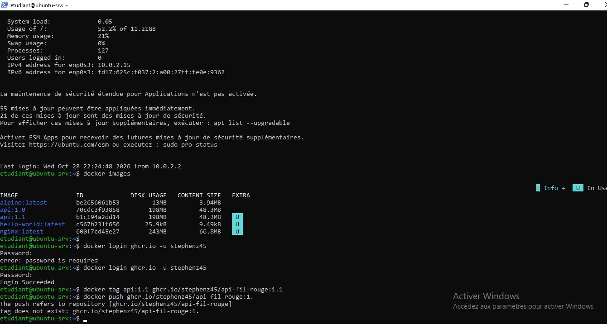

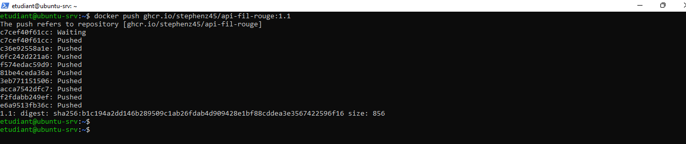

### 4.2 Vérifier que l'image se récupère depuis le registre

```bash
docker rm -f api
docker rmi ghcr.io/stephenz45/api-fil-rouge:1.1 api:1.1
docker run -d --name api -p 5000:5000 ghcr.io/stephenz45/api-fil-rouge:1.1
curl -s http://localhost:5000/version
```

Docker n'a pas trouvé l'image en local (`Unable to find image ... locally`), l'a téléchargée depuis `ghcr.io` (même digest `sha256:b1c194a2...` qu'au push), et l'API répond `{"version":"1.1"}`.

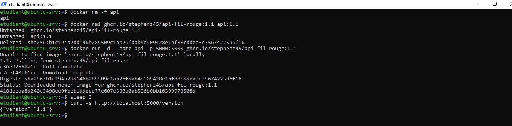

### 4.3 Nettoyer

```bash
docker rm -f $(docker ps -aq)
docker system df
docker image prune -a -f
docker system df
```

Docker reste installé dans la VM pour la séance 4.

| | Images | Conteneurs | Volumes locaux | Cache de build |
|---|---|---|---|---|
| Avant | 5 images, 352,3 MB (86,98 MB récupérables) | 0 | 0 | 110,3 MB |
| Après | 0 image, 149,7 MB (100 % récupérables) | 0 | 0 | 110,3 MB |

`docker image prune -a -f` affiche `Total reclaimed space: 40.94MB`.

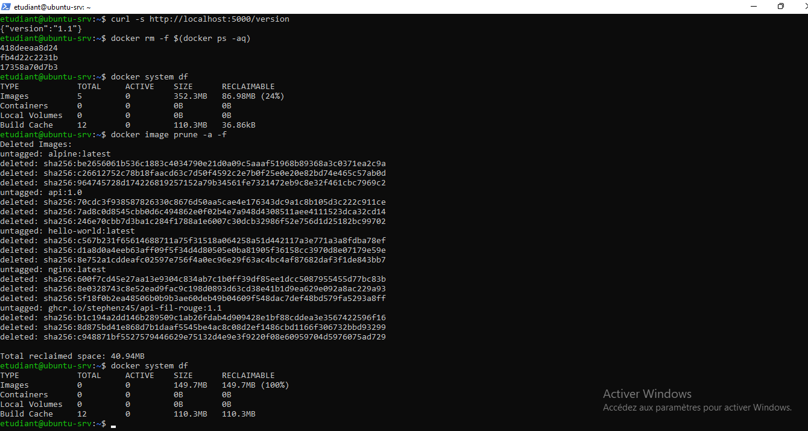

### Questions

**Q1. Adresse complète de l'image publiée ? Publique ou privée ?**
`ghcr.io/stephenz45/api-fil-rouge:1.1`. GHCR crée les images en **privé** par défaut ; la visibilité se change dans les paramètres du paquet sur GitHub (*Package settings*, *Change visibility*). Pour la récupérer depuis la VM, j'étais connecté avec `docker login`, ce qui fonctionne aussi pour une image privée.

**Q2. Pourquoi étiqueter l'image avec un numéro de version (`1.1`) plutôt que toujours `latest` ?**
Un tag de version désigne **toujours la même image** : on sait exactement ce qu'on déploie et on peut revenir à `1.0` si `1.1` pose problème. `latest` est seulement le tag par défaut et peut pointer vers n'importe quelle version selon le moment où l'on tire l'image : deux machines qui tirent `latest` à des dates différentes peuvent faire tourner un code différent, ce qui rend les déploiements non reproductibles.

**Q3. Quel espace disque `docker image prune` a-t-il libéré ? Dans le cloud, pourquoi faut-il aussi nettoyer les registres ?**
`docker image prune -a -f` annonce **40,94 MB** libérés. Le `docker system df` passe pour sa part de 352,3 MB à 149,7 MB pour les images, soit environ 200 MB de moins ; il reste 149,7 MB marqués 100 % récupérables (sans doute des données de couches que le moteur n'a pas encore libérées) et 110,3 MB de cache de build, qu'on peut vider avec `docker builder prune`. Dans le cloud, le stockage d'un registre est **facturé** et chaque nouvelle version poussée s'ajoute aux précédentes : sans nettoyage, les anciennes images s'accumulent (coût qui grandit, anciennes versions contenant des failles de sécurité qui restent téléchargeables). On définit donc des règles de rétention pour supprimer automatiquement les versions anciennes.

---

## Difficultés rencontrées et solutions

| Problème | Cause | Solution |
|---|---|---|
| `sudo update` : « command not found » | Commande incomplète | `sudo apt update` |
| `VBoxManage startvm ... --type headles` : « Invalid frontend name » | Faute de frappe | `--type headless` |
| `docker build` : `failed to fetch anonymous token ... unexpected EOF` | Coupure réseau passagère avec Docker Hub | Relancer la même commande : la construction a réussi |
| `docker login ghcr.io` : `denied` | J'avais collé le jeton à la place de l'identifiant (`-u`) | Retaper la commande avec `-u stephenz45` et coller le jeton au prompt du mot de passe |
| `docker login ghcr.io` : `error: password is required` (capture ci-dessous) | Mot de passe non saisi au prompt | Relancer la commande et coller le jeton au prompt `Password:` (`Login Succeeded`) |
| Jeton GitHub affiché dans le terminal | Même erreur : un jeton affiché en clair doit être considéré comme compromis | Jeton révoqué sur GitHub et remplacé par un nouveau |
| `ssh` : `kex_exchange_identification: Connection reset` | VM allumée mais bloquée (peu de mémoire libre) | Arrêt et redémarrage de la VM (`VBoxManage controlvm ... acpipowerbutton`, puis `startvm`) : images et fichiers étaient conservés |
| `docker push` : `tag does not exist ...:1.` | Tag incomplet (`:1.` au lieu de `:1.1`) | Relancer avec le bon tag |
| `curl` sans réponse juste après `docker run` | Flask pas encore démarré | Attendre quelques secondes (`sleep 3`) avant de relancer |

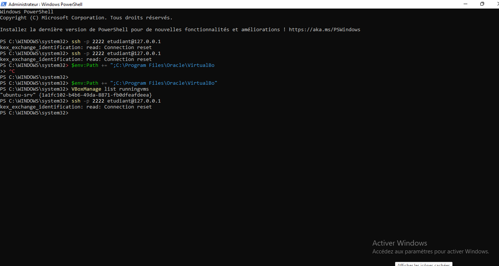

> Les captures 08 et 21 (navigateur) ont été recadrées pour ne montrer que la barre d'adresse et la page. La capture 26 montre le premier `docker login` refusé (`password is required`), puis le second réussi.

## Lien avec le cloud

- **Image et registre :** une image publiée dans un registre joue le même rôle qu'une image de machine (AMI) : on la déploie à l'identique partout (VM du cloud, service de conteneurs managé).
- **Élasticité :** lancer trois copies d'une même image en quelques secondes illustre la création d'instances à la demande.
- **Légèreté :** à fonction égale, un conteneur est des dizaines de fois plus petit et plus rapide à démarrer qu'une VM, donc moins coûteux à héberger.
- **Configuration et secrets :** la configuration passe par des variables d'environnement, et les secrets ne doivent jamais être inclus dans une image.
- **Coûts :** les registres et les disques sont facturés, d'où l'intérêt du nettoyage.

## Aide-mémoire des commandes

| Commande | Rôle |
|---|---|
| `docker run -d --name N -p H:C image` | Lancer un conteneur en arrière-plan, port H de la VM vers port C du conteneur |
| `docker ps` / `docker ps -a` | Conteneurs en cours / tous les conteneurs |
| `docker logs`, `docker exec`, `docker top`, `docker stats` | Journaux, commande dans le conteneur, processus, consommation |
| `docker build -t nom:tag .` | Construire une image à partir du Dockerfile du dossier courant |
| `docker images`, `docker history` | Lister les images, voir les couches |
| `docker tag`, `docker login`, `docker push` | Nommer, s'authentifier, publier dans un registre |
| `docker rm -f`, `docker rmi`, `docker system prune` | Supprimer conteneurs, images, tout ce qui est inutilisé |
| `docker system df` | Espace disque utilisé par Docker |

## Conclusion

Ce TP m'a montré qu'un **conteneur n'est pas une petite machine virtuelle** : c'est un processus de la VM isolé par le noyau, qui partage son noyau (même `uname -r`, même PID visible dans `ps aux`) mais embarque sa propre distribution (Debian dans l'image Nginx). Les mesures confirment qu'il est beaucoup plus léger (jusqu'à ×500 en taille, ×140 en mémoire) et plus rapide à démarrer qu'une VM, même si mes mesures de temps sont peu précises. J'ai aussi vu qu'il est éphémère (la page modifiée disparaît avec le conteneur) et qu'un volume permet de conserver des données.

J'ai ensuite conteneurisé l'API fil rouge : le Dockerfile, l'ordre des instructions et le cache de build (4,8 s au lieu de 41 s pour reconstruire), les variables d'environnement pour la configuration, puis la publication de l'image `ghcr.io/stephenz45/api-fil-rouge:1.1` sur GitHub Container Registry et sa récupération depuis le registre. Les incidents rencontrés (jeton affiché par erreur, VM bloquée, faute de tag) m'ont rappelé qu'un jeton est un secret à protéger et qu'il faut lire les messages d'erreur. Docker reste installé dans la VM pour la séance 4.
